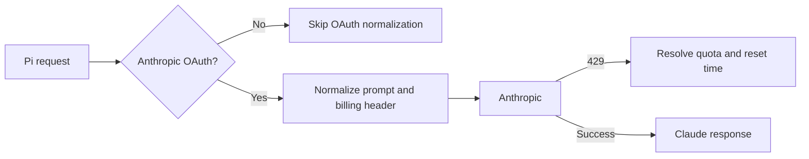

# pi-claude-oauth

Use a Claude Pro or Max subscription with [Pi](https://github.com/earendil-works/pi).

This extension adapts Pi's built-in Anthropic OAuth flow to the request format expected by Claude's subscription backend. It does not implement OAuth or bypass usage limits. It reads the installed Claude Code version from `claude --version` for request metadata.

> [!WARNING]
> This project is unofficial and is not affiliated with Anthropic. Using a Claude subscription outside Anthropic's own clients may conflict with Anthropic's terms. You use it at your own risk.

## Install

```bash
pi install npm:pi-claude-oauth
# or from GitHub
pi install git:github.com/HugoLopes45/pi-claude-oauth
```

## Setup

1. Install [Claude Code](https://docs.anthropic.com/en/docs/claude-code) and confirm that `claude --version` succeeds.
2. Install this package.
3. Start Pi and run `/login`.
4. Choose **Claude Pro/Max**.
5. Select an Anthropic model with `/model`.

The footer should show `✓ Claude OAuth ready`, then `✓ Claude OAuth active` after the first request.

OAuth prompt and quota normalization runs only when both conditions are true:

- the provider is `anthropic`
- Pi is using OAuth

API-key requests pass through unchanged.

## What it changes



For Anthropic OAuth requests, the adapter:

- removes Pi's docs block and any conflicting Claude Code identity block from the system prompt
- appends Pi docs as a persisted hidden message when the user asks about Pi, keeping earlier turns unchanged across requests and resume
- adds or updates the Claude billing header and client headers with the version reported by `claude --version`
- turns generic `429` responses into Claude-style limit and reset messages

On an ambiguous `429`, it checks Anthropic's OAuth usage endpoint and falls back to a minimal Haiku request. Results are cached for 30 seconds.

## Status

| Footer text | Meaning |
| --- | --- |
| `✓ Claude OAuth ready` | OAuth was detected and setup is valid. |
| `✓ Claude OAuth active` | A request was normalized. |
| `⚠ Claude OAuth setup` | Required Pi docs context could not be found. |
| `You've hit your ... limit` | Anthropic reported a subscription limit. |

No status appears for API-key sessions or other providers.

## Configuration

No configuration is required for normal use.

| Variable | Default | Purpose |
| --- | --- | --- |
| `PI_CLAUDE_OAUTH_REINJECT_SCOPE` | `pi-only` | `pi-only`, `always`, or `never` |
| `PI_CLAUDE_OAUTH_REINJECT_MODE` | `append-custom-message` | `none` disables injection; other values append persisted hidden context |
| `PI_CLAUDE_OAUTH_DOCS_FILE` | unset | Fallback file containing Pi docs context |
| `PI_CLAUDE_OAUTH_LOG_FILE` | unset | JSONL debug log path |
| `PI_CLAUDE_OAUTH_CLIENT_HEADERS` | `1` | Set to `0` to stop sending `user-agent` / `x-app` / `x-claude-code-session-id` |
| `PI_CLAUDE_CODE_ENTRYPOINT` | `pi` | Billing-header entrypoint |
| `PI_CLAUDE_CODE_WORKLOAD` | unset | Optional workload metadata |
| `PI_CLAUDE_CODE_SUBSCRIPTION_TYPE` | unset | Plan type used for limit labels |

Example:

```bash
PI_CLAUDE_OAUTH_REINJECT_SCOPE=always pi
```

Debug logs contain request metadata and provider errors. Review and redact them before sharing.

## Troubleshooting

If no status appears, confirm that `claude --version` succeeds, check `pi list`, select an Anthropic model, and log in through **Claude Pro/Max** instead of an API key.

If `⚠ Claude OAuth setup` appears, provide the docs context explicitly:

```bash
PI_CLAUDE_OAUTH_DOCS_FILE=/absolute/path/to/pi-docs-only.txt pi
```

To collect a debug log:

```bash
PI_CLAUDE_OAUTH_LOG_FILE="$PWD/claude-oauth-debug.jsonl" pi
```

Report bugs on [GitHub](https://github.com/HugoLopes45/pi-claude-oauth/issues). See the [changelog](./CHANGELOG.md) for release notes.

## Development

```bash
npm install
npm run check
npm pack --dry-run
```

Try a local checkout without installing it:

```bash
pi -e .
```

The extension entry point is [`extensions/index.ts`](./extensions/index.ts).

## Security

Pi extensions run with your user account's permissions. Review third-party extension code before installing it.

This adapter sends no telemetry and writes no logs unless `PI_CLAUDE_OAUTH_LOG_FILE` is set. Quota checks go to the configured Anthropic endpoint. The first-party OAuth usage endpoint is used only for `api.anthropic.com` sessions.

## License

[MIT](./LICENSE). Based on [minzique/pi-claude-oauth-adapter](https://github.com/minzique/pi-claude-oauth-adapter).
